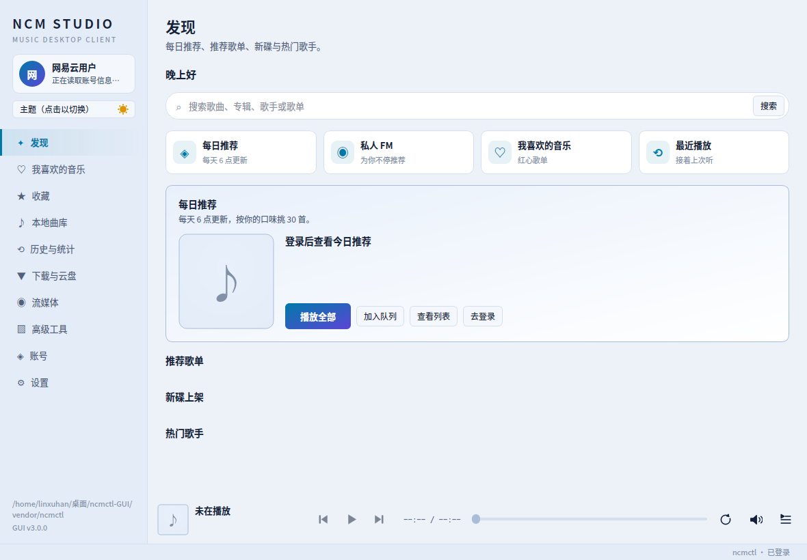
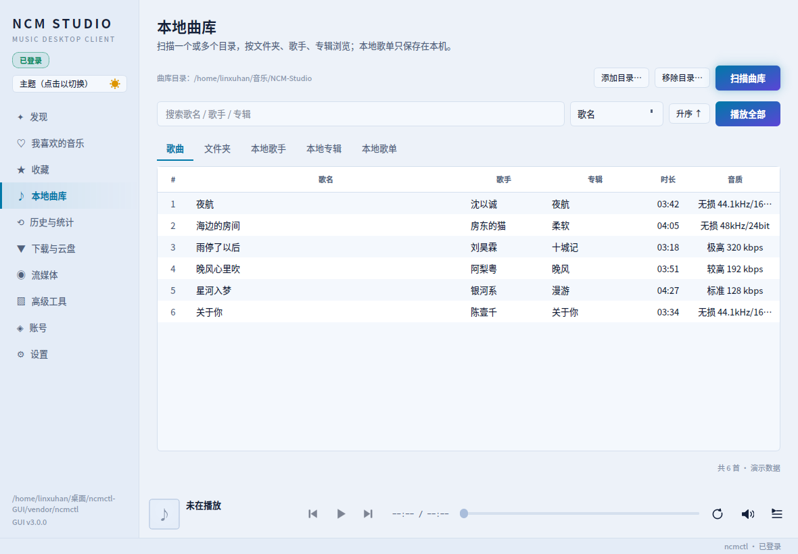
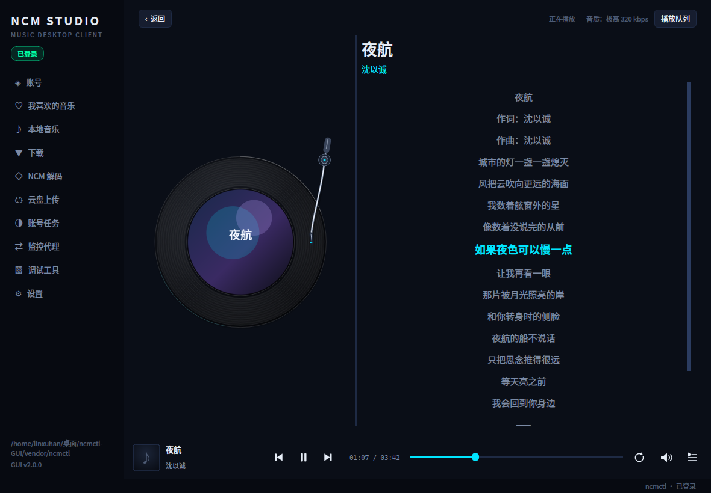
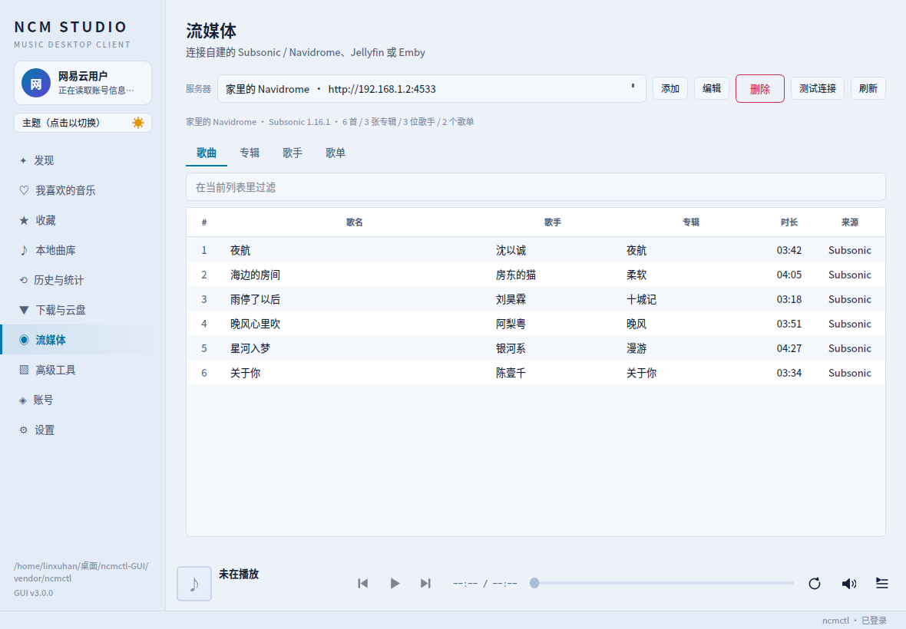
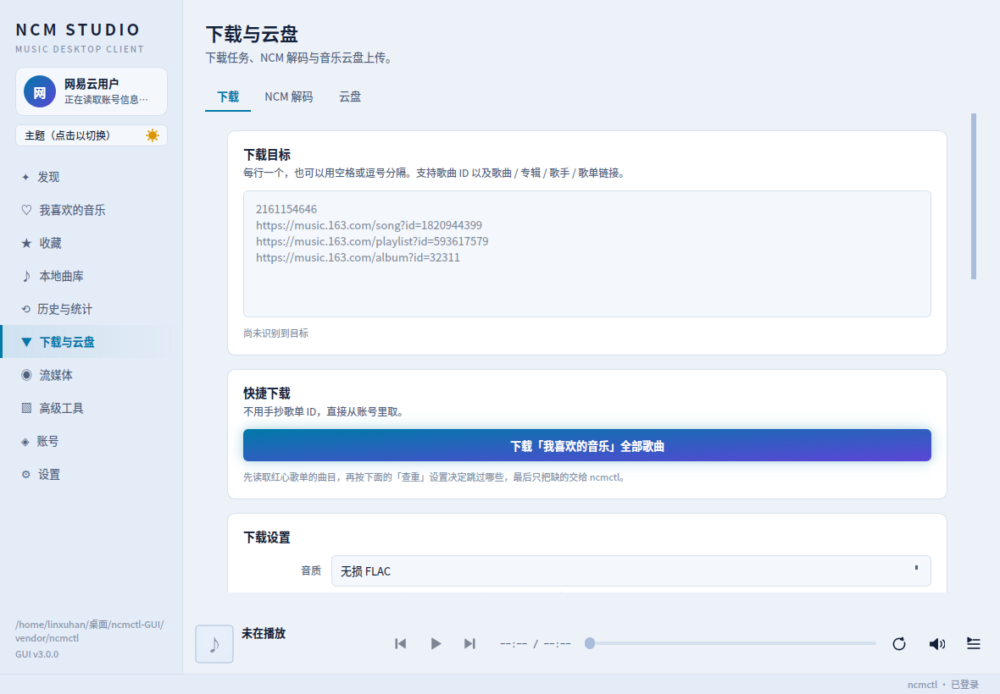

# NCM Studio

基于 [`ncmctl`](https://github.com/chaunsin/netease-cloud-music) 的第三方音乐播放器，PyQt6 编写，支持 **Windows / Linux / macOS**。

`ncmctl` 本身功能很全，但纯命令行用起来门槛不低：参数散落在各个子命令里，输出目录要手敲，
二维码登录得盯着终端。这个程序把这些都收敛成侧边栏导航 + 表单 + 实时终端输出，
重点解决**输出文件夹的可视化选择**和**长任务 / 扫码登录的可视化反馈**；
在此之上还补了播放页、歌词、本地曲库和队列，日常听歌可以完全留在界面里。
侧边栏可以在深色 / 亮色主题之间切换，选择会记进配置文件，下次启动保持原样。











## 功能覆盖

ncmctl 的全部子命令都在界面里有对应入口：

| 页面 | 对应命令 | 说明 |
| --- | --- | --- |
| 账号 | `login qrcode` / `phone` / `cookie` / `cookiecloud`、`logout` | 四种登录方式；扫码登录会在界面里显示二维码 |
| 发现 | 网易云 `/api/*` | 每日推荐、推荐歌单、新碟、推荐歌手；顶部搜索框直接搜歌曲 / 专辑 / 歌手 / 歌单，结果替换发现内容 |
| 我喜欢的音乐 | `SongPlayerV1` + 随包 mpv | 红心歌单列表，点一首即流播；播放页、歌词、队列、四种播放顺序 |
| 收藏 | 网易云 `/api/*` | 收藏的歌单 / 专辑 / 歌手三个 Tab，点进去看详情，可直接取消收藏 |
| 本地曲库 | 随包 mpv | 扫描下载目录或任意文件夹；歌曲 / 文件夹 / 本地歌手 / 本地专辑四个 Tab，支持本地歌单 |
| 历史与统计 | 本地 SQLite | 播放历史（最近 500 次，可搜索、清空、重播）与听歌统计（90 天热力图、24 小时分布、常听排行、音质构成）两个 Tab；可选把每轮听满 5 秒的实际收听时长同步到网易云账号的听歌记录（实验性，默认关闭） |
| 下载与云盘 | `download` / `ncm` / `cloud` | 下载任务队列、失败重试与历史记录；`.ncm` 解码；云盘列表、容量、播放、删除与上传 |
| 流媒体 | Subsonic / Jellyfin API | 连接自建的 Navidrome、Airsonic、Gonic、Jellyfin、Emby；歌曲 / 专辑 / 歌手 / 歌单浏览与播放 |
| 高级工具 | `sign` / `scrobble` / `partner` / `task`、`proxy`、`crypto` / `curl` | 账号任务、抓包代理与调试工具三个 Tab |
| 设置 | `update`、全局 `--home` / `-c` / `--debug` | ncmctl 定位、运行参数；本程序自身的自动更新 |

## 安装

### 直接用打包好的程序

到 [Releases](https://github.com/iamlinxuhan/NCM-Studio/releases) 下载对应平台的文件：

| 平台 | 文件 |
| --- | --- |
| Windows | `ncm-studio-windows-x86_64.exe` |
| Linux | `ncm-studio-linux-x86_64.AppImage` |
| macOS | `ncm-studio-macos-arm64` |

都是单文件，双击即可，**不需要装 Python，也不需要单独装 ncmctl**。

- **Windows**：SmartScreen 可能提示「已保护你的电脑」，点「更多信息 → 仍要运行」。
- **macOS**：首次打开会被 Gatekeeper 拦下，右键点图标选「打开」，或在终端执行
  `xattr -d com.apple.quarantine ./ncm-studio-macos-arm64`。
- **Linux**：给执行位就行，不需要 FUSE，也不需要 libfuse2。

  ```bash
  chmod +x ncm-studio-linux-x86_64.AppImage
  ./ncm-studio-linux-x86_64.AppImage
  ```

  AppImage 自带全部依赖（含 Qt 用到的 xcb / xkbcommon / wayland 等系统库），
  只有显卡驱动（libGL / libEGL / libdrm）是用你机器上的 —— 那一份必须用宿主
  自己的，打包进去反而会把硬件加速顶掉。

  > **glibc 下限是 2.35**，对应 Ubuntu 22.04 / Debian 12 及以上。
  > 这由 PyQt6 的 manylinux 标签与构建机决定，打包格式换不掉。
  > CI 里有一道检查（`packaging/check_glibc_floor.py`）卡着这个数，
  > 免得哪天构建机升级后悄悄把老用户挡在门外。

### 从源码运行

需要 Python 3.10+。ncmctl 不用你操心，下面这行会按平台下载并校验：

```bash
git clone https://github.com/iamlinxuhan/NCM-Studio.git
cd NCM-Studio

python3 -m venv .venv
.venv/bin/python -m pip install -r requirements.txt
.venv/bin/python scripts/fetch_ncmctl.py     # 下载 ncmctl 到 vendor/
```

用 [uv](https://github.com/astral-sh/uv) 会快很多：

```bash
uv venv && uv pip install -r requirements.txt
```

Windows 上把 `.venv/bin/python` 换成 `.venv\Scripts\python.exe`。

> 虚拟环境是隔离的，看不到系统 `dist-packages` 里的 PyQt6。
> 如果你的发行版已经装了系统级 PyQt6 又不想重复下载，
> 可以改用 `python3 -m venv --system-site-packages .venv`。

## ncmctl 是内置的

界面里每个按钮都对应 ncmctl 的一个子命令，两者必须一起测、一起发。所以**版本是钉死的**：
本程序分发的是 **ncmctl v0.8.1**（MIT 许可，版权归 [chaunsin](https://github.com/chaunsin/netease-cloud-music) 所有，
许可证随产物一并分发）。升级本程序时它跟着一起升，你不用单独管。

查找顺序是：

1. 「设置」页里指定的路径
2. 随程序分发的那一份
3. `PATH`
4. 各平台常见安装目录

第 1 项优先级最高，是为了留个逃生口 —— 你想用自己那份（比如想跟上游新版本、
或者要打某个自己编译的补丁），在「设置」页填上完整路径即可，填了就以它为准。

常见安装目录包括 `~/go/bin`、`~/.local/bin`、`/usr/local/bin`、`/opt/homebrew/bin`，
Windows 上另有 `%USERPROFILE%\go\bin`、`%LOCALAPPDATA%\Microsoft\WinGet\Links`、
`%USERPROFILE%\scoop\shims` 和 Chocolatey 的安装目录。四处都没有时，启动会直接提示
「找不到 ncmctl」并告诉你去哪填，不会闷声失败。

### 内置那一份不能自更新

用内置版本时，「设置」页的「立即更新」是**灰的**，下面写着原因。这不是偷懒：

内置副本要么在 AppImage 的只读挂载里，要么在单文件包的临时解包目录里。
`ncmctl update` 想原地覆盖自己，前者必然失败，后者改了也会在退出时随临时目录一起丢掉。
与其让你点了之后收到一句莫名其妙的写入错误，不如直接说清楚：**内置版本随本程序一同更新**。

想自己更新 ncmctl，就在「设置」页指定一份你自己的，那一项不受此限制。

## 运行

```bash
./run.sh
# 或者
.venv/bin/python main.py
```

## 输出目录

下载、NCM 解码、crypto / curl 的 `-o` 都用同一个路径选择控件：

- **选择…** 打开系统文件对话框
- **打开** 在文件管理器里直接定位到该目录，方便确认结果
- **默认** 一键回到默认目录
- 路径不存在、类型不对或不可写时，输入框边框会变色并给出说明

默认目录取自系统音乐目录（Linux 上是 XDG 音乐目录，中文环境通常是 `~/音乐`；
macOS 是 `~/Music`；Windows 是 `%USERPROFILE%\Music`），在其下建 `ncmctl` 子目录，
避免和已有曲库混在一起。所有选择都会持久化到配置文件，下次打开自动恢复。

「本地音乐」页默认也打开这个下载目录，但可以单独换成任意文件夹（记在
`player.local_dir`），不影响下载的输出目录。

## 查重与「下载我喜欢的音乐」

这两项是 ncmctl 自己不提供、由界面补上的能力。

**查重。** ncmctl 遇到输出目录里的同名文件不会跳过，而是改写成 `歌曲(1).flac`
再下一遍。界面在下载前先把目标展开成歌曲清单，按 ncmctl 自己的命名规则
（`歌手 - 歌名`，非法字符替换为 `_`）算出每首歌的文件名，与输出目录比对，
把已有的剔掉，只把缺的交给 ncmctl。

- 比对只看文件名主干，`.mp3` / `.flac` 都算命中
- `歌曲(1).flac`、`歌曲(2).flac` 这类历史重复文件同样视为已存在
- 开关默认打开，在「下载设置」里可以关掉，关掉后行为与直接用 ncmctl 一致
- 「仅查重」按钮只出报告不下载，可以先看清楚会跳过哪些

**下载我喜欢的音乐。** 「快捷下载」里的一键按钮：读取账号的红心歌单
（按 `specialType == 5` 定位，不是 UID），展开全部曲目，套用上面的查重，
只下载缺的那些。歌单链接会回填到目标框，点完之后还能看到一共多少首、
已经跳过多少首。

> 红心歌单动辄几百首，但接口只会返回前 10 条 `tracks`，程序是拿全量
> `trackIds` 再分批（每 500 个一批）查详情补齐的。

## 歌词

**ncmctl 不写歌词，也不写任何标签。** 它的 `--tag` 帮助文本明写着 "reserved for
compatibility; download tag writing is not implemented"，实测下完的 flac 里
`format_tags` 是空的 —— 连 `artist` / `title` 都没有，歌名歌手全靠文件名。
所以歌词是界面补的（见 [ncmgui/lyrics.py](ncmgui/lyrics.py)）。

「下载设置」里的**歌词**是四选一，下载正常结束后自动接一轮：

| 选项 | 做什么 | 动你的文件吗 |
| --- | --- | --- |
| **独立 .lrc 文件**（默认） | 在音频旁边放一个同名的 `.lrc` | 不动，只多一个新文件 |
| **逐字 .ttml 文件** | 在音频旁边放一个同名的 `.ttml`，带每个字/词的起止时间 | 不动，只多一个新文件 |
| 写入音频标签（内嵌） | 歌词写进音频文件自己的标签（flac 的 Vorbis 注释 / mp3 的 ID3 USLT / m4a / ogg / opus） | **会改写文件本身**，没有撤销 |
| 不下载歌词 | 什么都不做 | 不动 |

默认选 `.lrc` 是有意的：抓歌词要在下载之后再发几百个请求，万一失败或者某首歌
对不上，受影响的顶多是一个可以随手删掉的文本文件，而不是你刚下好的无损。
`.ttml` 同理，只是多了逐字时间，播放页会据此做逐字高亮。

歌词来源优先用 `LyricV1`：它返回的 `yrc` 字段带**每个字/词**的起止时间（普通
`lrc` 只有行级时间戳）。没有 `yrc` 时自动回退旧接口，译文 `tlyric` 按时间对应
到行上。YRC 的时间是绝对毫秒，解析时逐字累加字符区间，播放页不需要再猜。

普通 LRC 只有行级时间，播放页会把整行时长按词/字均摊（中文按字、西文按词），
合成一份近似的逐字时间再走同一条幕布渲染路径 —— 所以没有逐字歌词的歌也不会
退化成「整句一个颜色」。这份合成时间只用于显示，不会写进 `.ttml`。

几个实现上的取舍：

- **外文歌自动带中文翻译。** 接口的 `tlyric` 自带时间轴，按时间戳逐行插在原文
  下面。原文 `[00:32.500]` 和译文 `[00:32.500]` 对齐得挺好；对不上的宁可丢掉 ——
  强行按顺序配会把译文错位到别的句子上，比"这句没翻译"难发现得多。
- **没有歌词的就跳过。** 接口在查无歌词时返回 `[00:00.00]暂无歌词`，在纯音乐上
  返回 `[00:05.00]纯音乐，请欣赏`。这两种都是"只有一行占位文字"，照着写出去只会
  让曲库里多一堆内容为"暂无歌词"的 .lrc，所以判定用的是"去掉时间戳后还剩多少字"
  而不是比对固定字符串。
- **时间戳统一写成两位小数。** LRC 的小数位本该是百分秒，接口给的是毫秒
  （`[00:44.870]`）。多数播放器认三位，但 **Elisa 25.04 的解析器把三位当成百分秒再
  ×10**，`[00:44.870]` 被算成 52.7 秒 —— 一句歌词能晚出 9 秒，误差在 0～9 秒之间
  乱跳，表现就是"这句都唱完了歌词还没翻过去"。两位小数是 LRC 的标准写法，新老播放器
  都算得对，代价只是毫秒被截到厘秒（最多偏早 9 毫秒）。
- **接口哪天改了写法，不会静默出错。** 时间戳怎么解析不是按位数写死的：小数位是"秒的
  小数部分"，`.5` / `.50` / `.500` 都是半秒，接口给到四位五位也照样算得对 —— 所以
  "网易换个精度"这半个坑已经堵上（另一半是输出端，见上一条）。真的碰上认不出的花样
  （比如哪天变成 `[00:44,870]`）时，那几行会被当成"没有时间戳的正文"，译文对不上、
  时间轴会乱，**却一句错都不报** —— 所以程序会主动查一遍并在下载日志里点出来
  （"认不出的时间戳 `[00:44,870]`"），宁可吵一句，也不交给你一份看着正常、实则错位的
  歌词。已经见过的一种变体是时间戳后面挂编号（`[00:00.00-1]`），这种认识，且**原样保留**
  —— 看不懂的东西不擅自删。
- **已经带歌词的不重复问接口。** `.lrc` 存在、或者标签里已有歌词，就直接跳过 ——
  重复跑一遍几百首的曲库不会白费几百个请求。但"已有歌词"要**连写法一起看**：早期版本
  写进去的是毫秒时间戳，那种文件会被认成"还得再写一遍"，重跑一次就**就地改过来**，
  不用删了重下。
- **文件名对不上就不写。** 歌词要落到哪个文件上，是**扫输出目录反查**出来的，
  不是拿歌名去拼后缀：同一首歌可能落成 `.flac` 也可能 `.mp3`，重名时还会变成
  `歌曲(1).flac`，三种都得认。

## 封面

**ncmctl 同样不下载封面。** 封面地址就在解析结果的 `al.picUrl` 里，下载正常
结束后界面会顺手补一轮（见 [ncmgui/covers.py](ncmgui/covers.py)）。「下载设置」里的
**封面**也是三选一：

| 选项 | 做什么 | 动你的文件吗 |
| --- | --- | --- |
| **保存为同名图片**（默认） | 音频旁边放一张同名图片：`歌手 - 歌名.flac` → `歌手 - 歌名.jpg` | 不动，只多一个图片文件 |
| 写入音频标签（内嵌） | 写进 flac 的 picture、mp3 的 APIC、m4a 的 covr、ogg / opus 的 `metadata_block_picture` | **会改写文件本身** |
| 不下载封面 | 什么都不做 | 不动 |

- 图片地址会先升到 600×600（`?param=600y600`），避免把 130×130 的缩略图存下来；
- 落盘前按**文件头**判断真实格式，接口返回 HTML / JSON 时不会存出一个打不开的 `.jpg`；
- 已经有同名图片（或标签里已有封面）的直接跳过，重复跑不会重复下载；
- 本地音乐播放时按「同名图片 → 内嵌封面」的顺序找图，离线也有封面。

## VIP / 付费歌曲的标注

ncmctl 的下载日志只有进度条和一句 `report total: ...`，**从不提付费情况** ——
可拉不到音质的往往正是那几首。所以界面自己把 `fee` 字段带进来，标黄并加标记：

| 标记 | `fee` | 含义 |
| --- | --- | --- |
| `[VIP]` | 1 | 需会员才能听 / 下载所选音质 |
| `[付费专辑]` | 4 | 需先购买专辑 |
| `[VIP音质]` | 8 | 非会员只能听低音质 |

出现的位置：

- **下载进度行**，标记直接跟在歌名前面，整行标黄：

  ```
  [VIP音质]兰音Reine - 簪花记          [------------------↗     ] 23.06 MiB/25.83 MiB  89.25%
  ```

  这是最要紧的一处 —— 哪首歌卡住了、哪首位图失败，一眼就能对上号。

- **查重结果明细**里，每首歌名前面加标记（明细末尾附图例）
- **摘要行**加一句「待下载中 N 首需会员」
- **控制台的日志最前面**先列出这批里哪几首要会员

> ncmctl 的进度条只打文件名，不知道哪首需要会员。界面是在显示层把它对回
> 歌曲清单的，匹配时容忍两种差异：歌手之间的空格（`A,B` 与 `A, B`），以及
> pb 对超长标题的截断（`… - 宇宙一...` 仍能对回完整歌名）。

语气还会跟着账号的会员状态走 —— `GetUserInfo` 的 `vipType` 非 0 即视为会员：

- 是会员 → 「当前账号是会员，通常能下」
- 不是会员 → 「当前账号不是会员，多半会失败」
- 查不出来 → 不说满话，只提示「下载失败多半是它们」

> `fee` 的含义抄自 ncmctl 自己的注释（`api/weapi/song.go`）。未知的非 0
> 取值一律按 `[VIP]` 处理，宁可多标不可漏标。

## 流媒体播放

侧边栏的「我喜欢的音乐」直接列出账号红心歌单（序号、歌名、歌手、专辑、时长），
**点一行就开始播**，不必先下载。

点歌后内容区会切到**播放页**（左侧导航还在）：黑胶唱片样式的封面、逐行滚动并高亮
的歌词；进度与音量统一放在底部常驻播放条里，页内不再重复一套。黑胶与歌词之间的
分隔条可以拖动，**比例会被记住**，下次启动、下次打开播放页都按你调好的来 ——
整个窗口放大缩小时也保持这个比例，不会越拉越偏。主窗口的大小同样会记住，
下次启动按上次关闭时的尺寸打开；换了更小的屏幕则自动缩到可用区域。
右侧「播放队列」可展开，点任意一行直接跳播。左上角
「‹ 返回」或 `Esc` 回到刚才那一页。**自动下一首不会把界面拽回播放页** —— 你回到
下载页看进度时，音乐照常播。

底部播放条**全局常驻**，无论在哪一页都能看到上一首 / 播放暂停 / 下一首、进度、
音量和播放列表入口。播放顺序与播放列表收成了自绘图标，鼠标悬停会显示当前顺序；
音量是一个喇叭按钮，点开后在按钮上方弹出竖直滑条与百分比。左侧是当前歌曲的
小封面与歌名 / 歌手，**点它就回到播放页** ——
播放页不是导航项，从「返回」离开之后，这是最直接的回去路径（点「播放列表」也能
打开播放页，只是会顺带展开队列）。红心表格与本地音乐表格的第 0 列也会跟着变：
正在出声画暂停的两条竖条，暂停或停止画 `▶`。

播放顺序有四种，底部条和播放页都能切：

| 顺序 | 一首自然播完 | 手动「下一首」 | 到末尾 |
| --- | --- | --- | --- |
| 顺序播放 | 下一首 | 下一首 | 停 |
| 列表循环（默认） | 下一首 | 下一首 | 回第一首 |
| 单曲循环 | 重播当前 | 下一首 | 同顺序 |
| 随机播放 | 随机另一首 | 随机另一首 | 随机 |

随机的「上一首」会回历史，不会随机到一个完全陌生的地方。

### 蓝牙耳机与系统媒体键

Linux 上程序启动时会向会话总线注册一份 MPRIS 服务
（`org.mpris.MediaPlayer2.ncmstudio`）。蓝牙耳机传来的 AVRCP 指令由桌面的
`mpris-proxy` 转成 MPRIS 调用，所以耳机上的**播放 / 暂停、上一首、下一首**
都能直接控制本程序；GNOME / KDE 的键盘媒体键走的也是同一条路。

mpv 自己不实现 MPRIS，随包 mpv 又用 `--no-config --load-scripts=no` 启动，
所以这个接口由界面自己补（见 [ncmgui/mpris.py](ncmgui/mpris.py)）。它需要
纯 Python 的 `dbus-next`，已写进 `requirements.txt` 的 Linux 条件依赖，打包时
一并收进 AppImage。

Windows 与 macOS 的媒体控制分别走 SMTC / Now Playing，目前还没有接入；
这两个平台上的耳机按键暂时不会控制本程序。

### 流媒体服务器

侧边栏的**「流媒体」**页可以直接连自建音乐服务器，不需要网易云账号：

- 支持 **Subsonic 系**（Navidrome、Airsonic、Gonic、LMS、OpenSubsonic）与
  **Jellyfin / Emby**；「添加」里填地址、用户名和密码即可，Jellyfin 也可以只填
  API Key；
- 连接成功后的歌曲 / 专辑 / 歌手 / 歌单四个 Tab 都能双击播放；专辑、歌单再点
  进去看曲目，支持「播放全部」和「加入队列」；
- Subsonic 的认证是 `token = md5(密码 + 随机盐)`，密码不会出现在 URL 里；
  Jellyfin 用 API Key / AccessToken，同样只放在本机配置和播放地址的查询参数里；
- 服务器地址、密码、Token 保存在 `config.json`（POSIX 下 `0600`），日志、控制台
  与截图都不会输出这些字段；
- 播放时由主播放器统一取链，和网易云歌曲共用队列、歌词偏移、倍速、均衡器与
  定时关闭；流媒体歌曲的历史记录会保存 `服务器ID:曲目ID`，下次可以从历史直接重播。

> 内网服务器通常不走系统代理；流媒体请求固定直连，封面下载仍沿用「设置 → 更新」
> 里的代理配置。

### 播放本地音乐

侧边栏的**「本地曲库」**页不用登录、也不联网：

- 目录默认是程序的下载目录（`~/音乐/NCM-Studio`），也可以在页面顶部的路径控件里
  换成任意文件夹；选择会记在 `player.local_dir`，下次打开直接落在这里；
- 点表格任意一行即播，或用「播放全部」；
- 递归扫描（最多 5000 个文件，跳过隐藏路径），表格第 0 列跟着播放状态
  显示暂停竖条或 `▶`；
- 「音乐质量」列直接读文件头：FLAC 显示 `无损 44.1kHz/16bit`（超过 48kHz
  或 16bit 标 `Hi-Res`），MP3 / AAC 等显示 `极高 320 kbps`、`标准 128 kbps`
  这样的码率档位；读不出来时退回扩展名，坏文件不会影响整次扫描；
- 歌词按「同名 `.ttml` → 同名 `.lrc` → 音频标签里的内嵌歌词」查找；下载时合并进
  `.lrc` 的译文会在播放前拆出来，按「原文正常字号 + 译文小一号」排版，和在线歌词
  一致；封面按「同名图片 → 内嵌封面」的顺序找，都没有就显示占位图。

红心页底部还留着两个快捷入口：**本地音乐…**（选一个或多个文件）和
**播放下载目录**（把整个下载目录当队列），适合临时听几首。

### 实现取舍

- **播放器是 mpv，且随包。** Linux 与 Windows 的产物里已经带了 mpv 及其依赖库，
  新机器上不需要另装任何东西。macOS 首版不随包，先 `brew install mpv`（或在
  「设置 → 播放器」里指定路径）。
- **已下载的优先播本地文件。** 列表里的 `本地` 列有 `✓` 时说明输出目录里已经有这首，
  点击后直接播文件，既省一次接口调用，也不受直链过期影响。
- **直链是临时的。** 播放地址由 `SongPlayerV1` 现取（不是会消耗下载额度的
  `SongDownloadUrlV1`），约 20 分钟失效；界面只缓存到过期前 60 秒，所以不存在
  「用到过期地址」的路径。
- **播不了会明说。** 无版权、需要会员、该音质拿不到，都会在界面上给出具体原因；
  播放出错时**不会**自动跳到下一首 —— 否则一张 VIP 歌单会在你离开座位时被静默跳完。
- **封面只在内存里缓存**（最多 24 张），重启后重新下载；不落盘，省掉一套缓存目录
  的过期与清理规则。
- **歌词按代际号丢弃。** 快速连点几首歌时，先发出的歌词请求可能后到；页面只接受
  当前这一代的结果，不会出现「歌换了、词还停在上一首」。
- **逐字高亮是字形上的「幕布」。** 有 `yrc` 字时间时，当前行未唱的字是浅蓝
  `#a9d6ff`，已唱的字是深蓝 `#4a7fd0`；深色字形上叠一条横向软边遮罩，边缘落在
  字内部时同一个字从左到右连续变色。幕布移动速度由每个词自己的演唱时长决定，
  词与词之间的空隙按空隙时长匀速过渡。每 30ms 只重绘当前行的遮罩，不重建排版。
- **用户自己滚歌词后暂停自动跟随 3 秒**，免得刚往回翻两句就被拽回去。

音质档位与下载页相同（标准 / 较高 / 极高 / 无损 / Hi-Res），实际拿到的档位可能
低于所选 —— 接口以降级后的结果为准，界面会按接口返回的 `level` 播放。

## 自动更新本程序

「设置 → 更新本程序」固定在设置页最上方，会读 GitHub 的最新 Release，和当前版本比较：

- **每次启动检查**（可关）。发现新版会直接弹窗列出新版本与安装包大小，让你当场
  选择「下载并安装」或「稍后再说」；检查失败则静默跳过，不打扰启动；
- 点「下载并安装」后，先确认版本与大小，再下载并在写盘前校验 `SHA256SUMS`；
  **校验文件缺失或哈希不符就中止**，当前版本不受影响；
- 校验和本身还要用 `SHA256SUMS.sig` 做 Ed25519 验签。两个文件来自同一个
  Release，只比哈希等于让发布者自己给自己作证；签名私钥离线保管、不进 CI，
  公钥固定在程序里。**缺签名或验签失败同样拒绝安装**；
- 校验通过才替换。AppImage / macOS 用原子 `os.replace` 后重启；Windows 因为运行中的
  exe 不能覆盖，会交给一个等进程退出后重试替换的 PowerShell 小脚本；
- AppImage 的文件名里如果带版本号（如 `NCM-Studio-3.0.0-x86_64.AppImage`），替换后
  会改名到新版本，并同步更新 `.desktop` 里指向旧路径的 `Exec` / `TryExec`，避免出现
  「名字写着 3.0.0、内容是 3.0.3」或菜单项失效。文件名不带版本号则保持不变；
- 源码运行时不能替换（没有可替换的产物），按钮是灰的，只提示 `git pull`；
- 下载和检查都可以走「GitHub 代理」，留空用系统代理，填 `direct` 强制直连。

> 自动更新只做「下载 → 校验 → 验证签名 → 替换 → 重启」。任何一步失败都会保留
> 现有版本，并给出 Release 页链接供手动下载。

## 平台说明

界面代码本身是跨平台的，麻烦的只有一处：**子进程的伪终端**。

`ncmctl download` 一进来就调 `pb.StartPool()`，那个函数会去问「我的标准输出
是不是一块真终端」。不是的话它直接报错退出，**一个字节都下不了** ——
所以不能像普通程序那样给子进程接管道。

| 平台 | 方案 |
| --- | --- |
| Linux / macOS | 标准库 `pty.openpty()`，配合 `start_new_session=True` 让 `/dev/tty` 打不开，从而退回到程序给的 pty |
| Windows | [`pywinpty`](https://github.com/andfoy/pywinpty)（ConPTY，需要 Windows 10 1809+） |

Windows 上 `pywinpty` 已经写进 `requirements.txt` 的条件依赖，打包时会连同它
自带的 `conpty.dll` / `OpenConsole.exe` 一起进 exe，用户不需要额外装任何东西。
从源码跑的话 `pip install -r requirements.txt` 会自动带上。

> 注意「用 `cmd` / `powershell` 包一层」解决不了这个问题：包装进程自己的
> stdout 也是管道，它拉起的 ncmctl 继承的还是那条管道。

## 关于安全

- 本程序**不保存**你的账号密码。登录凭据由 ncmctl 自己写在 `~/.ncmctl/` 下，本程序只读取状态用于显示。
- 密码、CookieCloud 密码这类值会以命令行参数的形式传给 ncmctl，因而会出现在进程列表里 —— 这是 ncmctl 自身的接口限制。**介意的话请用扫码登录**，它不需要把任何凭据交给本程序。
- 粘贴的 Cookie 会先写入本程序配置目录下的私有临时目录（目录 `0700`、文件 `0600`）再传给 `--file`，避免直接出现在进程参数中，用完即删；异常退出留下的残留会在下次启动时清掉。
- 配置目录在 POSIX 上为 `0700`、配置文件为 `0600`，其他用户无法读取其中的路径、代理与账号标识。
- 界面回显和「复制命令」里的密码、请求头、XEAPI 密钥会显示成 `******`；真实参数只交给 ncmctl，不写进日志。
- 短信验证码通过控制台的 stdin 输入框送进 ncmctl：输入框是密码回显（只显示圆点），回显行和「导出日志」里只留「已隐藏」标记，不留原文；若终端把输入回显出来，后续输出里的同一串也会被抹掉。
- `--debug` 和「导出日志」可能包含请求头、响应体、Cookie 或 token。设置页在首次开启 `--debug` 时会明确警告，排查完请及时关闭。
- 监控代理的 CA 证书/私钥、XEAPI Session Key 属于敏感配置，请只放在本机可信目录；代理转发 HTTPS 走 `CONNECT` 隧道，TLS 仍端到端加密，但代理能看到目标域名。
- 登出、云盘上传、听歌任务、音乐合伙人、自更新这些会改动账号状态或不可逆的操作，执行前都有二次确认。
- **听歌记录同步是默认关闭的实验性功能。** 开启后，只有一轮实际听满 5 秒才会向网易云的网页日志接口补发开始动作，结束时再发送歌曲 ID 和实际收听秒数；快速切歌不会产生任何日志，也不上传本地文件路径、歌单或任何其他数据。每条日志在入队时固定当时登录的账号，后台发送前会重新读取 Cookie 并比对，排队期间切换账号或退出登录时直接丢弃，不会串到新账号。同一账号每小时最多 120 条，连续 3 次限流后自动暂停 10 分钟并在设置页提示。这属于网页端私有接口，不保证计入有效播放次数，也可能触发账号风控，设置页首次开启时会明确提示。

### 本地曲库的 SQL 安全

本地曲库、本地歌单、播放历史都在 SQLite 里。针对全部 SQL 执行点做过一次专项审计与实弹测试：

| 攻击面 | 实现方式 | 结果 |
|---|---|---|
| 搜索词（歌曲 / 历史） | `?` 占位符；`LIKE` 模式只作为**参数值**传入 | 用户输入不进入 SQL 文本 |
| 歌手 / 专辑 / 文件夹过滤 | 全部参数化；文件夹前缀用 `substr` / `instr`，刻意不用 `LIKE` | 目录名里的 `%`、`_` 不会变成通配符 |
| 排序（`ORDER BY`） | 字典白名单，未知键回退默认排序 | 注入串无法到达 SQL |
| 批量操作（`IN (...)`） | `",".join("?" for _ in ids)` 生成占位符，ID 先转 `int` | 值始终与 SQL 文本分离 |
| 歌单名 / 音频标签文本 | INSERT / UPDATE 全参数化 | 恶意文本只当普通字符串保存 |
| 数据库连接 | 无 `ATTACH DATABASE`、无 `file:` URI 模式、无动态 `executescript` | 没有额外的 SQLite 攻击面 |
| 文件夹 / 歌手 / 专辑聚合 | 全量查询后在 Python 侧聚合，不拼 `GROUP BY` 列 | 从设计上消除该类注入 |

实证测试覆盖 7 种经典载荷（`DROP TABLE`、`OR 1=1`、`UNION SELECT sqlite_master`、
`ATTACH DATABASE`、堆叠 UPDATE 等）× 5 个入口（曲库搜索、歌手/专辑过滤、文件夹、
历史搜索、歌单名），外加排序键注入：**全部载荷零穿透**，表结构与数据完好，没有未捕获异常。

默认数据库位于 `config_dir()/library.db`，配置目录权限 `0700`，其他用户无法进入。
通用直通层 `db.execute` / `db.query` 的项目约定是只传静态 SQL 与参数；需要动态子句时，
统一走 `queries.py` 里的白名单模式。

## 开发者说明

```bash
# 命令构建层的自检（纯函数，不需要 GUI）
.venv/bin/python -m ncmgui.ncmctl

# 目标解析 / 查重层的自检（纯函数，不需要 GUI、不联网）
.venv/bin/python -m ncmgui.resolver

# 歌词处理的自检（纯函数，不联网；需要 mutagen 才能验标签往返）
.venv/bin/python -m ncmgui.lyrics

# 封面：文件头识别、同名图片、flac / mp3 标签往返、跳过已有封面
.venv/bin/python -m ncmgui.covers

# 播放器 IPC 编解码与 mpv 定位（纯函数，不需要 mpv 在场）
.venv/bin/python -m ncmgui.player

# 封面地址改写、占位图与内存 LRU 缓存
.venv/bin/python -m ncmgui.images

# 本地音乐：文件名拆分、目录扫描、去重与上限
.venv/bin/python -m ncmgui.localmusic

# 自动更新：版本比较、平台资产名、SHA256SUMS 解析、Ed25519 验签、安装形态分支
.venv/bin/python -m ncmgui.updater

# 原子写文件与原子标签编辑（模拟失败，确认原文件不被破坏、无临时文件残留）
.venv/bin/python -m ncmgui.fsutil

# 代理串规范化（裸 host:port 补 http://，socks5 等明确拒绝）
.venv/bin/python -m ncmgui.netutil

# 证明随包的 mpv 真的能执行（打包产物自检用；源码运行则探测系统 mpv）
.venv/bin/python main.py --mpv-version

# 无头冒烟测试：构建整个界面、逐页实例化、跑一遍控制台逻辑
.venv/bin/python main.py --self-test

# 把每个页面渲染成 PNG（不依赖 X11 抓屏工具，Wayland 下也能用）
.venv/bin/python main.py --screenshot ./docs/screenshots

# 下载页的端到端集成测试。会真的调接口、真的下歌，需要已登录。
# 用临时目录当输出目录和配置，不动你的真实曲库与配置。
.venv/bin/python -u tests/gui_integration.py
```

### 自己打包

```bash
python scripts/fetch_ncmctl.py          # 先把 ncmctl 取到 vendor/
python scripts/fetch_mpv.py             # 再把 mpv 取到 vendor/mpv/（macOS 跳过）
pip install pyinstaller

# Windows：单文件（解压 mpv 的 .7z 需要 7-Zip；没有时退回 pip install py7zr）
NCMGUI_BUNDLE_NCMCTL=1 NCMGUI_BUNDLE_MPV=1 \
  pyinstaller ncm-studio.spec --noconfirm

# macOS：单文件，不随包 mpv
NCMGUI_BUNDLE_NCMCTL=1 pyinstaller ncm-studio.spec --noconfirm

# Linux：onedir + AppImage
NCMGUI_MODE=onedir NCMGUI_BUNDLE_NCMCTL=1 NCMGUI_BUNDLE_MPV=1 \
  pyinstaller ncm-studio.spec --noconfirm
bash packaging/make_appimage.sh \
  dist/ncm-studio dist/ncm-studio-linux-x86_64.AppImage
```

`NCMGUI_BUNDLE_NCMCTL=1` / `NCMGUI_BUNDLE_MPV=1` 分别表示「这个产物必须有 ncmctl /
mpv」，缺了直接报错而不是警告一下照常产出 —— 一个不含 ncmctl 的包发出去，用户那边
是每个功能都用不了；不含 mpv 则是「点歌没反应」。

Linux 上 `fetch_mpv.py` 收的是**构建机上装的那份 mpv**，所以要先
`sudo apt-get install -y --no-install-recommends mpv`；它会把 `/usr/bin/mpv` 与
`ldd` 闭包一起复制到 `vendor/mpv/`，其中 glibc 家族和图形驱动库按策略留给宿主机
（理由同 `packaging/bundle_libs.py`）。Windows 那份从 zhongfly/mpv-winbuild 的日期
tag 下载，版本与 SHA-256 钉在脚本里。

Linux 之所以是 onedir 而不是单文件，是因为 AppImage 必须建在目录树上：单文件包在
运行时还会把自己再解包一次，套进 AppImage 就成了双重解包，启动慢且白占一份临时空间。

CI（`.github/workflows/build.yaml`）在推 `main` 时会三平台各打一次包（只出产物、
不发 Release），用来尽早暴露某个平台特有的构建问题；打 `v*` tag 时会额外创建一个
**草稿** Release。

### 发布流程（签名在本地做）

签名私钥只保存在发布者机器的 `~/.config/ncm-studio-release/signing-key.pem`
（目录 `0700`、文件 `0600`），**不进仓库、不进 CI**。CI 只有仓库写权限，拿不到私钥，
所以它只建草稿；草稿不会被 `releases/latest` 返回，客户端在签名完成前看不到新版本。

首次使用先生成密钥，并把打印出的公钥填进 `ncmgui/updater.py` 的 `PUBLIC_KEY_B64`：

```bash
.venv/bin/python scripts/release_sign.py keygen
```

之后每次发版：

1. 改版本号、提交、打 tag、推送（如 `v2.2.0`）；
2. 等三平台 CI 跑完，确认草稿 Release 里三个安装包和 `SHA256SUMS` 都在；
3. 本地签名、复核并转正：

   ```bash
   .venv/bin/python scripts/release_sign.py sign v2.2.0 --publish
   ```

   脚本会下载 `SHA256SUMS`、用离线私钥生成 `SHA256SUMS.sig`、上传，再用程序
   内置公钥复核一遍，全部通过才把草稿转为正式 Release。

也可以随时独立复核从 Release 页面下载的两个文件：

```bash
.venv/bin/python scripts/release_sign.py verify SHA256SUMS SHA256SUMS.sig
```

> 私钥丢失后无法再为旧版本签名；换钥只能先用旧私钥发一次带新公钥的版本，
> 之后的版本再用新私钥签。

CI 里有三类断言，都是同一个思路 —— **「打包成功」不等于「东西真的进去了」**：

| 断言 | 防的是什么 |
| --- | --- |
| 清点 `conpty.dll` / `OpenConsole.exe` 等（Windows） | pywinpty 的非 `.pyd` 二进制不在依赖分析里，漏了不报错，只在用户那边变成「一下载就失败」 |
| 清点内置的 `ncmctl`（三平台） | 同上，缺了的话整个界面一个功能都用不了 |
| 清点 `mpv` 并真跑一次 `--mpv-version`（Linux / Windows） | 文件在、有执行位都证明不了它能启动；少收一个 `.so` 要到用户点播放才暴露 |
| `check_glibc_floor.py`（Linux） | 构建机越新，收进去的系统库要求越高。在 Ubuntu 24.04 上打的包到 Debian 12 上会 `GLIBC_2.39 not found`，而构建、上传、发布全都不报错 |

最后一条是最容易忽略的：PyInstaller 会把**构建机**的 libglib、libgtk、libstdc++、
libxcb 一起收进产物，这些库在构建机的 glibc 上编译，于是产物的实际门槛被构建机决定，
和 PyQt6 自己的 manylinux 标签没关系。所以 CI 里 Linux 任务**固定跑在 `ubuntu-22.04`
上**，不要图省事改成 `ubuntu-latest` —— 那是目前唯一能同时满足 PyQt6（≥2.34）和
Debian 12 / Ubuntu 22.04 用户（≤2.35）的档位。

### 代码结构

```
main.py                入口，含 --self-test / --screenshot
ncm-studio.spec        PyInstaller 打包配置（三平台共用）
scripts/
  fetch_ncmctl.py      下载并校验 ncmctl 到 vendor/（版本与 SHA-256 钉在里面）
  fetch_mpv.py         收集 mpv 到 vendor/mpv/（Linux 走 apt + ldd，Windows 走钉死的 .7z）
  release_sign.py      离线生成发布密钥、给 SHA256SUMS 签名并转正草稿 Release
  make_icon.py         生成图标（纯几何绘制，不依赖字体）
packaging/
  ncm-studio.png/.ico  图标，已入库（免得构建期还要装 Pillow）
  ncm-studio.desktop   Linux 桌面项
  AppRun               AppImage 入口
  bundle_libs.py       把 Qt 需要的系统库收进 AppDir
  check_glibc_floor.py 检查产物真正能跑的最低 glibc，超线即失败
  make_appimage.sh     组装 AppDir + 打 AppImage
tests/
  gui_integration.py   下载页端到端测试（真实调接口、真实下载）
ncmgui/
  resources.py         包内资源定位（按 __file__，onefile / onedir 都成立）
  ncmctl.py            命令构建：把界面选择翻译成参数数组（不依赖 Qt）
  resolver.py          目标解析与查重：展开 id/链接 → 歌曲清单 → 比对输出目录（不依赖 Qt）
  lyrics.py            歌词：解析 LRC / YRC / TTML、逐字时间、写 .lrc/.ttml 或音频标签（不依赖 Qt）
  covers.py            封面：文件头识别、同名图片、读写音频标签里的封面（不依赖 Qt）
  fsutil.py            原子写文件与原子标签编辑（同目录临时文件 + fsync + os.replace）
  netutil.py           代理串校验与规范化（不依赖 Qt）
  player.py            播放器：定位 mpv、JSON IPC 收发、事件解析、直链缓存（不依赖 Qt）
  playback.py          全局播放控制：队列、四种播放顺序、进度外推与竞态保护
  dsp.py               音频工具：mpv 能力探测、倍速/变调/EQ/响度/设备
  mpris.py             Linux MPRIS 服务：蓝牙耳机与系统媒体键（dbus-next）
  images.py            封面下载、放大、占位图与内存 LRU 缓存
  localmusic.py        本地音乐：文件名拆分、目录扫描（不依赖 Qt）
  lyrics_service.py    歌词获取/解析/缓存与全局偏移，播放页和桌面歌词共用
  download_manager.py  下载任务队列、失败重试与历史（JSON，0600）
  updater.py           GitHub Release 检查、校验与自我替换（不依赖 Qt）
  runner.py            subprocess + pty 封装，流式输出为信号（POSIX / Windows 双后端）
  workers.py           后台任务（守护线程），用于不阻塞界面的解析
  config.py            配置持久化
  theme.py             调色板、全局 QSS、霓虹辉光
  window.py            侧边栏 + 页面栈 + 底部播放条 + 作业控制台
  api/                 网易云 /api：Cookie 只读复用、请求限流、模型归一化、写操作
  library/             SQLite 曲库、扫描、本地歌单、播放历史与统计
  streaming/           Subsonic 系与 Jellyfin/Emby 适配器、服务器配置与取链
  desktop/             桌面歌词窗与系统托盘
  dialogs/             播放工具、评论、加入歌单
  widgets/             Card、FormCard、ConsolePanel、PlaybackBar、Vinyl、歌曲表格/封面网格/分页
  pages/               十个导航页 + 搜索页 + 播放页（player.py，不是导航项）+ 详情宿主；
                       groups.py 把历史/统计、下载/NCM/云盘、账号任务/代理/调试合成标签页
```

几条设计约定：

1. **命令一律以参数数组传递，绝不拼 shell 字符串。** 路径里的空格、中文、引号都不需要转义，也不存在注入问题。
2. **命令构建层不依赖 Qt。** `ncmgui/ncmctl.py` 和 `ncmgui/resolver.py` 都是纯函数集合，可以脱离界面单独测试，见上面的自检命令。
3. **子进程跑在伪终端上，不是管道。** 原因见上面的「平台说明」。另外 pty 尺寸必须
   用 `TIOCSWINSZ` / ConPTY 的 `dimensions` 报成正常行列数 —— 默认的 0×0 会让
   进度条库算出宽度 0，整条进度渲染成空白。
4. **pty 输出要按增量方式解码。** UTF-8 是变长编码，而 `os.read` 按字节返回，
   一个汉字正好跨在读取边界上时两半会被分开解码，日志里就出现 `��`。用
   `codecs.getincrementaldecoder` 把没凑齐的字节留到下一轮。

## 许可

本程序是 ncmctl 的第三方前端。ncmctl 本身以 MIT 许可发布，版权归 chaunsin 所有。
它的许可证与 README 会随产物一起分发（打包后在 `ncmgui/assets/ncmctl/` 下），
这是分发第三方二进制应尽的义务，不是可有可无的点缀。

本项目以 **AGPL-3.0** 发布，见 [LICENSE](LICENSE)。3.0.0 起由 GPL-2.0 升级；
如果你分发修改后的版本，需要按 AGPL 第 13 条向网络用户提供对应源码。

功能设计参考了 [SPlayer-Next](https://github.com/SPlayer-Dev/SPlayer-Next) 的公开行为与
网易云接口用法，但代码按 Python/Qt 架构重新实现，不包含其源文件。SPlayer-Next 以
AGPL-3.0 发布，与本项目兼容。

「写入音频标签」这一种歌词模式用到 [mutagen](https://mutagen.readthedocs.io/)，它同样以
GPL-2.0-or-later 发布，可升级到 GPL-3.0 并与 AGPL-3.0 组合。默认的「独立 .lrc 文件」不需要它。

流媒体播放用到的 [mpv](https://mpv.io/) 以 GPLv2+ 发布，它链接的 FFmpeg 等库各有
自己的许可。Linux / Windows 的产物里随包分发 mpv，其来源、版本与版权文件放在
`vendor/mpv/`，打包后位于 `ncmgui/assets/mpv/`（AppImage 与单文件包内的
`mpv/` 目录旁）。本程序只以子进程方式调用 mpv，不修改其源码。

作者：iamlinxuhan &lt;2276677131@qq.com&gt;
